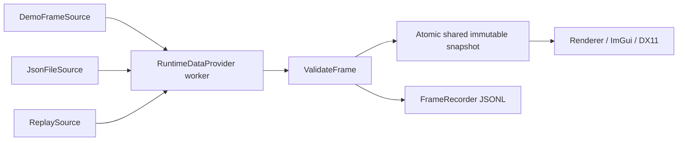

# Visual ESP Overlay 0.4 — внешнее чтение и подключаемые источники Frame

C++20, Windows x64, DirectX 11, DirectComposition, Dear ImGui, CMake. PR #1 и PR #2 интегрированы в `work`; версия 0.4 продолжает существующий проект на базе PR #3.

Приложение поддерживает **Demo**, **локальный JSON**, **Replay JSONL** и **Live memory (Windows x64)**. Последний читает память выбранного процесса стандартными read-only Windows API по отдельно проверенному layout. Поставляется отдельный процесс-стенд; подтверждённых структур DBD 10.2.2 и подключения к игре нет. Demo и генератор JSON используют синтетические данные. Версия `10.2.2` в `offsets.json` остаётся меткой, реальные адреса равны `null` и не используются. Внешний JSON обозначается `LOCAL JSON (unverified producer)`: наличие файла не подтверждает происхождение данных из игры.

## Скачать и запустить

В GitHub выберите ветку `feature/windows-live-memory-reader`, папку `downloads`, затем **Download raw file** для нужного ZIP:

- `VisualESPOverlay-demo-win64.zip`: `VisualESPOverlay.exe`, консольный `frame_tool.exe`, `offsets.json`, `config.example.json`, `example.frame.json`, `EspMemoryFixture.exe`, `fixture_layout_tool.exe`, соответствующий `memory.fixture.json`, документация, отчёт исследования в docs/ и лицензии.
- `VisualESPOverlay-source.zip`: исходники, CMake, примеры и тесты без build-каталогов и вложенных архивов.

Распакуйте Windows ZIP в доступную для записи папку и запустите `VisualESPOverlay.exe`. По умолчанию включён Demo. Меню открыто; **Insert** скрывает его и включает click-through. Настройки `config.json` и относительные пути источников/записей разрешаются рядом с exe, независимо от рабочего каталога. Образец `config.example.json` не перезаписывает существующие настройки: его можно скопировать в `config.json` или сохранить настройки кнопкой **Save**.

## Реальные данные DBD 10.2.2: состояние исследования

**Подтверждённого подключения к реальной игре нет.** Подходящий документированный spatial feed не найден в прочитанных материалах; актуальные сайты BHVR/Steamworks/Overwolf блокируются прокси этой среды. Это не доказывает отсутствие любых партнёрских или новых интерфейсов. Полный отчёт с источниками, датами, доступными/недостающими полями и ограничениями — [docs/DBD_DATA_SOURCES.md](docs/DBD_DATA_SOURCES.md); журнал — [docs/dbd-source-evidence.json](docs/dbd-source-evidence.json).

В существующем HUD добавлена строка **DBD 10.2.2: NOT CONNECTED**. LIVE по-прежнему означает свежие кадры выбранного транспорта, а не подключение к DBD. Demo, локальный JSON, Replay и явно помеченный fallback сохранены; имя source и произвольные JSON-поля не подтверждают происхождение данных. Фиктивный DBDDataSource/режим dbd не добавлен.

```powershell
.\frame_tool.exe dbd-status
$LASTEXITCODE # 3: ожидаемое unavailable, не ошибка передачи тестовых кадров
```

Команда сообщает возможности данного binary и не обращается к игре или запущенному overlay. `connected`, `adapter_implemented`, `live_session_validated` равны false. Интерфейс, FOV, стрелка/сектор, hotkeys и click-through сохранены.

## Сборка Visual Studio 2022

Windows 10/11 x64, VS2022 **Desktop development with C++**, MSVC v143, Windows SDK 10/11, CMake 3.24+ и Git. Зависимости ImGui 1.91.9b и nlohmann/json 3.11.3 закреплены по точным upstream commit, HTTPS-проверка включена.

Из корня проекта в Developer PowerShell for VS 2022:

```powershell
cmake --preset vs2022-x64
cmake --build --preset release --parallel 2
ctest --preset release
.\build\vs2022\Release\VisualESPOverlay.exe
```

Также можно открыть корень через **File → Open → Folder** и выбрать preset `vs2022-x64`. При MSVC нужен Microsoft Visual C++ Redistributable x64. Поставляемая кросс-сборка MinGW статически включает его собственный runtime; дополнительные DLL MinGW не требуются. Windows/DX11/DWM остаются системными зависимостями. Нативная сборка MSVC и графический запуск на Windows не проверяются выполнением Linux-тестов; фактические результаты находятся в `VALIDATION.md`.

## Существующие визуальные функции

Все пять категорий сохранены: survivors с рамками/именами/дистанцией, killer с отдельным цветом, generators `G`, hooks `H`, exit gates `E`. На VISUALS доступны имена, дистанции, цвета, предел дальности и бюджет отрисовки. Demo показывает четыре survivors, killer, два generators, два hooks и два exit gates, движущуюся камеру и объекты.

| Управление | Действие |
|---|---|
| Insert | Меню / click-through |
| F1 | Все визуальные элементы |
| F2 / F3 | Survivors / Killer |
| F4 / F5 / F6 | Generators / Hooks / Exit Gates |
| F7 / F8 | Имена / Дистанции |
| End | Выход |

Глобальное опрашивание клавиш не блокирует их получение другими приложениями. Меню можно перемещать и менять его размер. Закрытие крестиком включает click-through. Overlay покрывает основной монитор и предназначен для рабочего стола и оконного/borderless режима; exclusive fullscreen не поддерживается.

Camera vertical FOV регулируется от **60 до 120°** и передаётся в DemoProvider через `CameraSettings`. Killer плавно поворачивает единичный `lookDirection` со скоростью 0.35 рад/с. Стрелка от головы и опциональный горизонтальный сектор проецируются через WorldToScreen. Полный угол сектора **30–120°**, длина стрелки/радиус сектора **1–20 м**; цвет RGB, непрозрачность контура и заливки настраиваются отдельно. Сектор не учитывает препятствия. Если направления нет, визуализация направления отсутствует. Для вертикального направления горизонтальный сектор не строится; сегменты за near/far и почти направленная в камеру стрелка пропускаются.

FOV управляет демокамерой. Локальные снимки и Replay предоставляют готовую матрицу: настройка Demo FOV не переписывает внешнюю или записанную камеру.

## Выбор источника и восстановление

На **CONFIG** выберите источник и путь, затем **Apply source / restart replay**. Поля источника и записи применяются этой кнопкой. **Load** применяет сохранённый источник; **Reset defaults** возвращает Demo. **Save** сохраняет настройки, но не включает неподтверждённые изменения источника без Apply. Цвета, FOV и визуальные переключатели меняются со следующего кадра.

| Источник | Поведение |
|---|---|
| Demo | Локальные синтетические кадры; источник по умолчанию |
| Local JSON | Полный снимок из обычного файла; автоматическое повторное чтение после изменения файла |
| Replay | Потоковое чтение записи JSONL с сохранением относительных интервалов; необязательный цикл |

Каждый Frame — **полная замена** набора объектов. Отсутствующие ID удаляются сразу при принятии следующего снимка. Пустой валидный снимок удаляет все объекты и сохраняет состояние LIVE. Никакие ID или указатели предыдущего Frame не используются для построения следующего.

JSON-производитель должен обновлять `sequence` и атомарно заменять файл чаще stale timeout. Неизменившийся `sequence` не считается heartbeat. Изменившаяся последовательность, включая сброс при рестарте производителя, принимается. Повторная публикация того же sequence после обнаруженного удаления файла также поддерживается. Метаданные файла позволяют пропускать повторный парсинг больших неизменённых снимков; производитель обязан обновлять mtime/содержимое при публикации.

По умолчанию polling — **16 мс**, stale timeout — **1000 мс**. При потере файла последняя валидная сцена удерживается не дольше timeout, затем очищается. Некорректные данные очищают сцену сразу. Latest также проверяет срок годности независимо от worker: задержавшийся источник не оставляет просроченные объекты на экране. Polling продолжается: при появлении валидного нового снимка состояние автоматически возвращается LIVE. Ожидание следующего timestamp в Replay сохраняет кадр; EOF без цикла оставляет последний кадр с явным статусом **REPLAY ENDED**. Изменение файла Replay запускает его заново; удаление обнаруживается как потеря источника.

**Use labelled demo when source is lost** по умолчанию выключено. При включении на пустом/потерянном источнике показывается `DEMO FALLBACK`, а статус основного источника остаётся виден. Восстановление автоматически убирает fallback. Тестовые данные не выдаются за реальные.

## Локальный JSON: проверяемый сценарий

В папке распакованной Windows-сборки запустите второй PowerShell:

```powershell
.\frame_tool.exe generate frames.json 11
.\frame_tool.exe validate frames.json
.\frame_tool.exe publish frames.json 600 11
```

В overlay выберите **Local JSON**, путь `frames.json`, нажмите Apply. Генератор публикует 600 синтетических кадров, целевой интервал 16 мс. После завершения timeout очистит сцену. Повторный запуск publish восстановит её. Одна статичная JSON-копия не является непрерывным источником: после timeout она станет stale.

Схема снимка версии 1 показана в `examples/frame.json` (в Windows ZIP — `example.frame.json`) и формируется тем же сериализатором, который использует приложение:

| Поле | Формат |
|---|---|
| schema_version | Целое `1` |
| sequence / timestamp_us | Неотрицательные целые uint64; timestamp информационный, timeout считает локальное время получения |
| source | UTF-8, до 256 байт; runtime выводит собственную метку происхождения |
| camera.position | Массив из трёх чисел, метры |
| camera.view_projection | Массив из 16 конечных чисел, row-major |
| entities | Полный массив, до 10000 объектов |
| entity.id | Уникальное ненулевое целое uint64 внутри снимка |
| entity.kind | `survivor`, `killer`, `generator`, `hook`, `exit_gate` |
| entity.name | UTF-8 до 256 байт без управляющих символов |
| entity.position / top | Трёхмерные мировые координаты: ноги/маркер и верхняя точка |
| entity.look_direction | Необязательный/null либо конечный единичный вектор из трёх чисел |

Дробные, отрицательные и строковые ID отвергаются. Производителям на JavaScript необходимо сохранять uint64 без округления JSON Number (обычные безопасные целые до 2^53−1 подходят). Координаты и элементы матрицы ограничены по модулю 10^6; матрица должна быть невырожденной. Для направления допускается погрешность длины 0.01. Некорректный объект отвергает **весь** снимок. Максимальный JSON — 8 MiB, глубина вложенности — 32. Эти проверки выявляют структурные ошибки, но не доказывают происхождение данных или физическую правильность камеры.

Контракт координат: метры, левосторонняя система, `+Y` вверх, `+Z` вперёд; row-major матрица умножается на вектор-столбец, `clip = projection * view * world`, глубина DirectX `0..w`. Viewport — client area overlay в физических пикселях. Внешний производитель должен согласовать матрицу с этим viewport/aspect; yaw 0 смотрит к +Z, положительный yaw поворачивает к +X.

Реализован файловый транспорт JSON. Для дополнительного IPC-транспорта предусмотрен IFrameSource; named pipe/shared-memory адаптер в эту версию не входит.

## Запись и воспроизведение

На CONFIG включите **Record frames**, задайте `capture.jsonl`, нажмите Apply. Записываются только новые принятые кадры (и явно помеченные fallback-кадры, если включён fallback). Ошибка записи отображается отдельно и не останавливает получение/отрисовку. После ошибки запись можно повторно включить через Apply.

JSONL содержит по одной записи `{recording_version, session, elapsed_us, frame}` на строку. Временная шкала Replay использует `elapsed_us`, а не несинхронизированные часы производителя. Сессии дописываются в файл; начало новой сессии получает новую относительную временную шкалу. Кадры сбрасываются на диск после записи. Один процесс/worker должен владеть выходным файлом; конкурентное многопроцессное дописывание не поддерживается.

Запись не перезаписывает существующий файл. Перед append проверяются первая запись и завершение последней строки; неподходящий или обрезанный файл отвергается. Ограничение файла — **256 MiB**; по достижении лимита запись останавливается с диагностикой. Выход записи должен отличаться от входного JSON/Replay. Первая запись проверяется перед append; для проверки всего существующего файла используйте validate.

```powershell
.\frame_tool.exe record recording.jsonl 120 11
.\frame_tool.exe validate recording.jsonl
```

После этого выберите Replay → `recording.jsonl` → Apply. **Loop replay** задаёт повтор; та же кнопка перезапускает запись с начала. Replay читает один следующий кадр, не загружая всю запись в память. `frame_tool validate` проходит запись без ожидания реального времени. Генератор, publisher и recorder создают только синтетические данные.

## Архитектура и потоки



- `IDataProvider`: исходный контракт Sample; DemoProvider сохранён. RuntimeDataProvider совместим с ним, но Sample возвращает копию для старых клиентов.
- `IFrameSource::Poll(ReadContext)`: подключаемый адаптер. Вызывается только worker-потоком, обязан возвращаться за ограниченное время; результат Ready/Unchanged/Scheduled/Disconnected/Invalid/Ended.
- `RuntimeDataProvider::Latest()`: основной путь renderer. Возвращает `shared_ptr<const RuntimeSnapshot>` с неизменяемым Frame и согласованной диагностикой. `atomic<shared_ptr>` гарантирует безопасную публикацию, но не заявляется lock-free.
- Камера/aspect передаются через короткую блокировку SetContext. Получение, JSON, валидация и запись выполняются worker-потоком; renderer не читает файлы.
- Stop пробуждает ожидание и присоединяет worker; повторные и одновременные Stop безопасны. Удерживаемые читателем снимки остаются неизменяемыми после последующих публикаций и остановки.
- Для нового источника реализуйте IFrameSource, возвращайте полный Frame в описанном формате и зарегистрируйте создание в MakeFrameSource. Модули runtime не зависят от DirectX или ImGui.

Файлы: `frame_io.*` — схема, валидация и recorder; `frame_sources.*` — адаптеры; `runtime_provider.*` — поток, публикация и диагностика; `renderer.*` — визуализация; `config.*` — настройки; `overlay.*` — Win32/DX11; `frame_tool.cpp` — воспроизводимые примеры.

## Производительность и диагностика

HUD показывает render FPS, частоту принятых кадров источника, длительность последнего poll/валидации, возраст последнего валидного кадра, состояние источника, fallback, запись, число объектов, видимых кандидатов и отрисованных объектов. Invalid polls считает отклонённые попытки получения, включая повторную диагностику неизменённого повреждённого файла.

Рендерер читает общий неизменяемый Frame без копирования. Сначала отсеиваются выключенные категории, дальность по квадрату расстояния и невидимые объекты. Среди оставшихся через `nth_element` выбираются ближайшие до **Draw budget** (по умолчанию 1500; предел 10000), затем сортируется только выбранная часть. Scratch-буфер сохраняет capacity; текстовые подписи используют string_view. Большой снимок не приводит к бесконечной очереди: доступен только последний опубликованный Frame. Сектор и стрелка учитывают общий переключатель, Killer и дальность.

Проверяемая нагрузка сериализации/валидации (это не измерение DX11 FPS):

```powershell
.\frame_tool.exe benchmark 10000 10
```

## Автоматические проверки

Portable CTest: исходные математика/FOV и конфигурация, сериализация, некорректные данные, конкурентные читатели/worker, исчезновение/timeout/восстановление JSON, запись/Replay, снимок 10000 объектов и CPU ImGui geometry/budget. Дополнительно проверяются поддельные признаки подключения JSON/fallback и точный ожидаемый exit code 3 команды dbd-status. CPU ImGui тест проверяет построение команд отрисовки без GPU и не заменяет проверку прозрачности окна.

Linux/macOS, C++20-компилятор, CMake и Git:

```sh
cmake -S . -B build/core -DESP_BUILD_OVERLAY=OFF -DESP_BUILD_CONFIG_TESTS=ON -DESP_BUILD_RENDER_TESTS=ON -DESP_BUILD_TOOLS=ON -DCMAKE_BUILD_TYPE=Release
cmake --build build/core --parallel 2
ctest --test-dir build/core --output-on-failure --parallel 2
./build/core/frame_tool benchmark 10000 10
```

Зависимости скачиваются при первом конфигурировании. Для повторного использования ранее полученных исходников доступны стандартные `FETCHCONTENT_SOURCE_DIR_JSON` и `FETCHCONTENT_SOURCE_DIR_IMGUI`. Без включения дополнительных тестов и tools portable-сборка выполняет только исходный core_tests без загрузок.

MinGW-w64 x64:

```sh
cmake -S . -B build/windows -DCMAKE_TOOLCHAIN_FILE=cmake/mingw-x64.cmake -DESP_BUILD_OVERLAY=ON -DCMAKE_BUILD_TYPE=Release
cmake --build build/windows --parallel 2
```

## Ручная проверка Windows

1. Запустить Demo, проверить все категории, цвета, F1–F8, направление/сектор, FOV 60/120° и Save/Load старого и нового config.json.
2. Скрыть меню Insert и кликнуть по приложению под overlay; вернуть меню и проверить ввод. Изменить разрешение основного монитора.
3. Запустить publish, выбрать Local JSON, проверить счётчики. Остановить publisher: после timeout сцена очищается. Запустить снова: LIVE восстанавливается.
4. Включить fallback и повторить потерю: появляется явный DEMO FALLBACK; восстановить publisher и проверить исчезновение fallback.
5. Записать кадры, остановить запись, открыть Replay с циклом и без, проверить тайминг и статус EOF. Проверить плохой JSON и недоступный путь записи.
6. Опубликовать 10000 объектов, ограничить Draw budget, проверить HUD; завершить End.

Текущая версия содержит универсальный read-only транспорт памяти, но не содержит проверенных смещений или подтверждённого подключения к DBD. Для будущего реального адаптера нужны подтверждённые идентификаторы/категории, координаты, направления, камера, viewport и преобразование единиц; их отсутствие не мешает всем поставляемым режимам.


## Live memory: отдельный процесс Windows x64

Подробный контракт, ограничения и проверка: [docs/LIVE_MEMORY.md](docs/LIVE_MEMORY.md). Исследование API зафиксировано, новых поисков не проводилось.

```powershell
cmake --preset vs2022-x64
cmake --build --preset release --parallel 4
ctest --preset release
# Отдельное окно PowerShell:
.\build\vs2022\Release\EspMemoryFixture.exe
# Основное окно:
.\build\vs2022\Release\VisualESPOverlay.exe
```

В существующей вкладке CONFIG выберите **Live memory (Windows x64)**, оставьте **Verified memory layout** равным `memory.fixture.json`, нажмите **Apply source**. Путь разрешается рядом с overlay. Стенд публикует пять категорий через собственную память; LiveFrameSource не вызывает DemoProvider. Имя процесса/модуля, PE fingerprint, экспорт и все смещения находятся в отдельном JSON, автоматически созданном из настоящего exe стенда. `offsets.json` с null-адресами DBD остаётся неиспользуемым.

В live-режиме FOV берётся из матрицы внешнего источника: ползунок Demo FOV не меняет камеру чужого процесса. Live reader не пишет в процесс. Прежние категории, цвета, стрелка/сектор, hotkeys, click-through, запись и Replay сохранены. Live не подставляет Demo даже при `fallback_demo=true`. Исчезнувшие ID отсутствуют в следующем полном снимке; invalid снимок очищает сцену, зависший sequence истекает по `stale_ms`, завершение процесса приводит к повторному поиску и открытию нового handle.

Workflow **Windows memory pipeline** собирает MSVC x64 Release и запускает CTest, включая реальные OpenProcess/ReadProcessMemory, изменение координат/камеры, удаление, ошибки, stale и reconnect. Второй Windows-тест использует существующие Overlay и RenderEntities, захватывает backbuffer DX11 и проверяет цветные пиксели рамки в рассчитанной области. Артефакт содержит exe, layout, JSON-отчёты, BMP и журнал. Состояние фактического запуска указано в VALIDATION.md; наличие теста в репозитории само по себе не означает его успешного выполнения.


Для запуска стенда с готовыми настройками скопируйте `examples/config.memory-fixture.json` в `config.json` рядом с exe. Это явно выбирает live_memory; источник данных — EspMemoryFixture.exe, а не DBD. Для переупаковки существующей Windows-сборки: `python tools/package_release.py build/windows` (либо каталог Release нативной сборки). Скрипт проверяет CRC и побайтовое содержимое обоих ZIP.


Проверено на нативной Windows Server 2022/MSVC x64 Release: **14/14 CTest**, включая отдельный процесс, чтение через RPM, восстановление и реальные пиксели DX11. Linux Release: **12/12**. [CI и native Windows artifact](https://github.com/psenicynarsenij-ship-it/DBD-soft-project/actions/runs/39996145579), [подробные результаты](VALIDATION.md), [сохранённое свидетельство](docs/windows-memory-evidence.json). Подключение к DBD 10.2.2 этими тестами не подтверждается.
